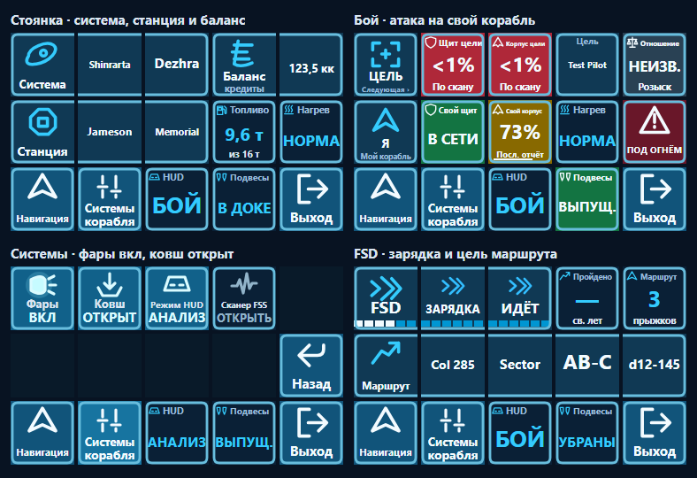
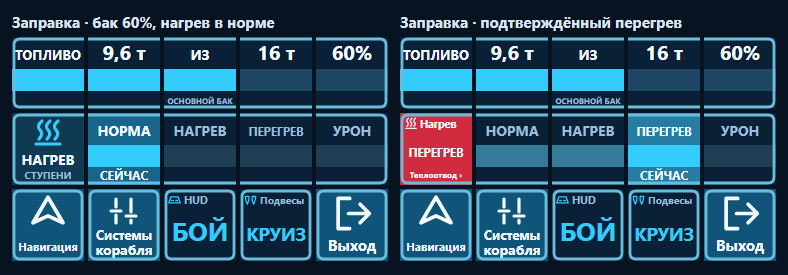

# CHA Dynamics MFD для Stream Deck

Корабельная панель **Elite Dangerous** для Windows и классического **Elgato Stream Deck MK.1**. Два верхних ряда клавиш работают как приборы. В полёте они показывают систему и запас топлива, при гиперпрыжке — состояние FSD, под огнём — свой корабль и выбранную цель. Нижний ряд остаётся на месте, поэтому «Навигация», «Системы» и «Выход» всегда под рукой.

**[Скачать установщик 2.5.1](https://github.com/RacerCHA/cha-dynamics-elite-mfd-streamdeck/releases/download/v2.5.1/CHA-Dynamics-MFD.streamDeckPlugin)** · [Готовый выпуск и контрольные суммы](https://github.com/RacerCHA/cha-dynamics-elite-mfd-streamdeck/releases/tag/v2.5.1) · [Каталог CHA Dynamics Elite Dangerous](https://github.com/RacerCHA/cha-dynamics-elite-dangerous)



Изображения здесь — рендеры действительных клавиш плагина на синтетической телеметрии. Каждая клавиша занимает 72 × 72 пикселя, как на MK.1.

## Установка и первый запуск

1. Подключите **MK.1 с 15 клавишами (5 × 3)** и откройте приложение Elgato Stream Deck. Требуются Windows 10/11 x64, Stream Deck 6.6 или новее и Elite Dangerous для ПК с журналом версии 4.x. Контрольная конфигурация — Stream Deck 7.6, игра 4.2 и Node.js 24.
2. Установите **Node.js 24 x64** в стандартную папку Windows для программ. Локальный загрузчик ищет `nodejs\node.exe` внутри `Program Files`. Команда `node --version` должна показать `v24…`. [Скачать Node.js](https://nodejs.org/en/download)
3. Дважды щёлкните скачанный **CHA-Dynamics-MFD.streamDeckPlugin** и подтвердите установку в Stream Deck. В комплект входит отдельный профиль **Elite MFD** для MK.1. Если приложение предложит добавить его, выберите свой MK.1.
4. Проверьте список профилей устройства. Если **Elite MFD** отсутствует, скачайте отдельный файл профиля и откройте его двойным щелчком. Его также можно импортировать через настройки Stream Deck, вкладку **Профили → Импорт**. Достаточно одной копии профиля. [Скачать чистый профиль 5 × 3](https://github.com/RacerCHA/cha-dynamics-elite-mfd-streamdeck/releases/download/v2.5.1/CHA-Dynamics-MFD.streamDeckProfile)
5. Вернитесь в свой повседневный профиль. В списке действий найдите категорию **CHA Dynamics MFD**, перетащите действие **MFD Elite Dangerous** на свободную клавишу. Нажмите её на устройстве. В нижнем ряду появятся **Навигация · Системы корабля · HUD · Подвесы · Выход**. «Выход» возвращает к предыдущему профилю.
6. Панель можно открыть до запуска игры. Для проверки телеметрии войдите в кабину своего корабля. В обзоре должны появиться сведения о системе и топливе. Откройте «Системы», включите фары привычной игровой клавишей и проверьте, что значок лампы и подпись меняются.

## Назначения управления

Плагин читает назначения **текущего пользователя Windows** при каждом нажатии. В этом выпуске поддерживается корабельный пользовательский пресет **Custom** в файле **Custom.4.2.binds**. Его выбирает вторая строка `StartPreset.4.start`. Путь к папке — `%LOCALAPPDATA%\Frontier Developments\Elite Dangerous\Options\Bindings`. Установщик не копирует чужой пресет. Назначения добавляются в настройках игры.

Откройте **Настройки → Управление → Управление кораблём**, найдите нужную функцию и задайте свободную клавиатурную привязку. Если используете HOTAS, оставьте его на своей позиции и используйте свободное второе назначение. Следите за предупреждениями игры о совпадениях.

| Клавиша панели | Действие корабля в игре |
| --- | --- |
| Карта галактики / Карта системы | `GalaxyMapOpen` / `SystemMapOpen` |
| Линии орбит / Следующая система маршрута | `OrbitLinesToggle` / `TargetNextRouteSystem` |
| Внешняя камера | `PhotoCameraToggle` — вход в Camera Suite и возврат в кабину |
| Фары / Грузовой ковш | `ShipSpotLightToggle` / `ToggleCargoScoop` |
| Сменить HUD / Сканер FSS | `PlayerHUDModeToggle` / `ExplorationFSSEnter` |
| Цель / Подвесы / Теплоотвод | `CycleNextTarget` / `DeployHardpointToggle` / `DeployHeatSink` |

Для первого запуска проще выбрать свободные **F1–F12**. Также распознаются буквы латиницы и русской раскладки ЙЦУКЕН, цифры, пробел, Insert, Home, Equals и сочетания с Ctrl, Alt или Shift. Например, для внешней камеры подходит левый Ctrl + левый Alt + пробел. При выборе клавиш учитывайте горячие клавиши своих оверлеев.

**Для ковша выберите назначение без Home**, например F9, если она у вас свободна. Плагин предпочитает второе клавиатурное назначение ковша и исключает Home. Для остальных функций используется первое доступное клавиатурное назначение. Команды отправляются только при активном окне Elite Dangerous.

## Что показывает панель

- **Обзор.** Система, станция или состояние полёта, баланс, нагрев и основной бак. Баланс сокращается до «к», «кк» и «ккк». Топливо ниже 50% отмечается жёлтым, ниже 15% — красным пульсом.
- **Навигация и FSD.** В меню пять команд, включая внешнюю камеру. При зарядке и прыжке видны фаза и подтверждённые данные маршрута. Через 8 секунд после последнего нажатия меню закрывается и появляются актуальные приборы.
- **Бой.** При захваченной цели верхняя строка относится к ней, нижняя — к вашему кораблю. Слева сверху «Цель» выбирает следующий корабль. Без захвата панель показывает самооборону. HUD и подвесы считываются независимо.
- **Заправка у звезды.** Основной бак занимает пять клавиш, под ним отдельный ряд ступеней нагрева. Ёмкость берётся из комплектации текущего корабля и обновляется при замене баков. Резервуар в расчёт не входит. При смене корабля панель ждёт согласованных показаний.
- **Нагрев.** При подтверждённом перегреве или термоповреждении появляется «Теплоотвод ›». Одно нажатие отправляет одну команду. На экране заправки нажимают левую клавишу теплового ряда.



## Данные и ограничения

Плагин локально читает `Journal.*.log` и `Status.json` из `%USERPROFILE%\Saved Games\Frontier Developments\Elite Dangerous`. Связь с приложением Elgato идёт через локальное соединение. Учётные записи внешних сервисов не нужны. Здесь предполагается стандартное размещение Saved Games; перенаправленные каталоги автоматически не обнаруживаются.

Свой щит показывает «В сети» или «Сбит». Процент корпуса — последний подтверждённый отчёт. Щит и корпус цели доступны по скану, показания скрываются через 30 секунд. «Розыск» — правовой статус. Игра не всегда сообщает реальное отношение цели. «Под огнём» означает общий обстрел; отдельного штатного сигнала о летящей ракете панель не получает. Нагрев корабля показан ступенями, точного обратного отсчёта FSD и живого счётчика боезапаса здесь нет.

## Если что-то не работает

| Симптом | Что проверить |
| --- | --- |
| На панели только «Офлайн» | Войдите в игру до кабины. Проверьте, что в стандартной папке Saved Games обновляются журнал и Status.json. |
| Действия появились, но вход не открывает панель | Проверьте наличие отдельного профиля **Elite MFD** для MK.1. Кнопка входа добавляется в обычный профиль из категории **CHA Dynamics MFD**. |
| Клавиши не рисуются | Проверьте путь к Node.js из шага 2, версию приложения Stream Deck и наличие плагина в списке установленных. |
| Приборы работают, но команды дают предупреждение | Верните фокус игре, выберите корабельный Custom и проверьте поддерживаемое клавиатурное назначение. Одного HOTAS-бинда для этих команд недостаточно. |
| Не срабатывает ковш | Проверьте, что у корабельного ковша есть клавиша без Home и эта клавиша сама работает в игре. У SRV отдельное назначение. |
| Фары или HUD меняются с задержкой | Показание меняется после обновления Status.json игрой. Меню можно открыть снова; изменения с клавиатуры и HOTAS тоже отображаются. |

## Сборка из исходников

В Windows нужны Python 3, Node.js 24 и штатный компилятор .NET Framework x64. Запустите из корня:

```powershell
python build.py
node tests/verify.js
node tests/verify-combat.js
node tests/verify-camera-fuel.js
node tests/verify-ship-tanks.js
```

Сборка создаёт установщик и чистый профиль в `dist`. Тесты используют временные телеметрические файлы и подставной отправитель ввода.

Независимый проект CHA Dynamics. Elite Dangerous принадлежит Frontier Developments, Stream Deck — Elgato.
